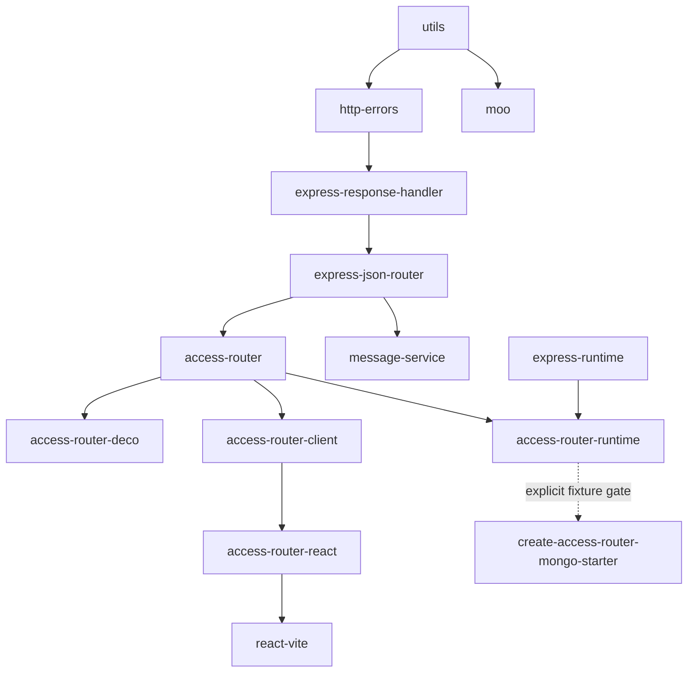
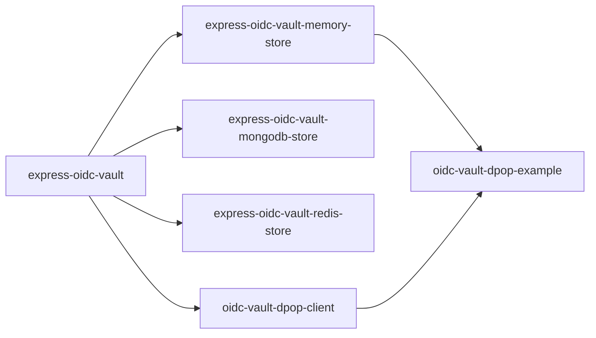

# Dependency-gated GitHub Actions test pipeline

Created: 2026-11-18 11:17:23 PST (`20261118-111723`, generated with `date`).

Status: in_progress. The user authorized implementation by sequential sub-agents after this plan was created on 2026-11-18. Pushes, workflow dispatches, and repository-settings changes remain unauthorized.

## Objective and scope

Replace the single grouped unit-test job with a visible, dependency-aware GitHub Actions job graph:

- Run independent package tests concurrently on isolated runners/checkouts.
- Start dependent tests only after their upstream package tests succeed. In particular, an `access-router` failure must prevent `access-router-deco` and other downstream tests from starting.
- Keep unrelated branches running after a failure, rather than cancelling the entire test graph.
- Reduce elapsed test time and distribute resource pressure, while measuring repeated setup/build costs rather than assuming lower total runner usage.
- Preserve one stable required unit-test result that cannot pass because failed prerequisites caused downstream jobs to be skipped.

Scope: `.github/workflows/test.yml`, CI-specific setup/build-artifact helpers, a checked CI dependency model and its tests, root test scripts, and testing documentation.

Non-goals:

- No package production/API changes, removal of test coverage, or replacement of package `test` commands with smaller subsets.
- No removal of package-script dependency rebuilds in the first migration.
- No concurrent local group/build execution in one checkout. Keep `pnpm test`, `pnpm test:grouped`, and the 12 individual local group commands safe and available.
- Do not redesign publishing, release artifacts, lint, or the existing minimum-Node compatibility lanes. Preserve their independent execution and existing blocking/non-blocking behavior.
- Do not silently change branch protection, runner provisioning, or the current Markdown-only workflow trigger exclusions.

## Analysis coverage, evidence, and limits

Reviewed revision: `0fda5197c5b950e865af73681225c8bbf5533775`. The working tree was clean before creating this file.

Inspected the main test workflow, shared setup actions, workspace manifests discovered through `pnpm`, local group runner/tests, testing documentation, representative cross-package fixtures, and real-browser configurations/harnesses.

| Finding                                                                        | Inspected evidence                                                                                                                                                                                                                      | Planning consequence                                                                                                                                   |
| ------------------------------------------------------------------------------ | --------------------------------------------------------------------------------------------------------------------------------------------------------------------------------------------------------------------------------------- | ------------------------------------------------------------------------------------------------------------------------------------------------------ |
| All grouped unit tests currently share one runner                              | `.github/workflows/test.yml:26-63` (`unit-test`); `scripts/test-groups.mjs:145-175` (`runTestGroups`)                                                                                                                                   | Split execution into isolated test jobs, not concurrent groups sharing a checkout.                                                                     |
| There are 25 tested workspaces in 12 local groups                              | Read-only `pnpm -r list --depth -1 --json` plus manifest inventory; `scripts/test-groups.mjs:10-23` (`testGroups`)                                                                                                                      | Every tested workspace must remain covered exactly once in the main CI test plan.                                                                      |
| Existing groups mix unrelated dependency families                              | `scripts/test-groups.mjs:15-22` pairs router/OIDC packages and runtime/PDF tests                                                                                                                                                        | Do not use old group numbers as success-gate boundaries: a router failure must not unnecessarily skip OIDC tests.                                      |
| Current validation models build/read safety, not upstream test-success gates   | `scripts/test-groups.mjs:56-127` (`dependencyClosure`, `testAccess`, `validateTestGroups`); `scripts/test-groups.test.mjs`                                                                                                              | Add a separate CI test DAG contract without weakening the local safety validator.                                                                      |
| Upstream tests use already-compiled downstream fixtures                        | `scripts/test-groups.mjs:28-49` (`testAccessOverrides`); `packages/access-router/test/contracts/packed-consumer-compatibility.test.ts:133-157,180-184`                                                                                  | Build availability and test-success dependencies are different graphs. Preparation must supply fixtures without introducing reverse test gates/cycles. |
| Starter tests execute the runtime CLI despite no declared workspace dependency | `packages/create-access-router-mongo-starter/tests/generated-tooling.test.ts:207-254`                                                                                                                                                   | Include an explicit runtime-to-starter test gate, with a documented fixture rationale.                                                                 |
| Three test workspaces require real Playwright browsers                         | `packages/express-request-attestation/vitest.browser.config.mts`; `packages/pdf-reader/vitest.browser.config.mts`; `apps/oidc-vault-dpop-example/vitest.browser.config.ts`; `apps/oidc-vault-dpop-example/test/browser/harness.ts:4-20` | Browser setup belongs to these jobs. The DPoP example defaults to Chromium and supports selected additional engines.                                   |
| Shared setup is substantial and will repeat on runners                         | `.github/actions/setup-tools/action.yml:7-38` installs Python/tooling; `.github/actions/setup-npm/action.yml:6-13` installs root and website dependencies                                                                               | Audit requirements and measure setup cost before promising lower aggregate runner usage.                                                               |

Bounded task searches found no existing plan for dependency-gated GitHub Actions tests. The completed [access-router test-contract separation](20261108-094712-access-router-test-contract-separation.md) is related fixture context, not work to reopen.

Checks actually run during planning: read-only workspace/dependency inventory confirmed **25 tested workspaces and 12 local groups**; `git status --short` confirmed the clean starting tree; `git rev-parse HEAD` identified the revision above.

Not run during planning: build, lint, runtime/package tests, `pnpm test:groups:check`, artifact round trips, or GitHub Actions runs. No current duration, peak-memory, billing, or runner-quota baseline is claimed. Full fixture/resource classification and live failure-propagation verification remain implementation work.

### Planning-deliverable verification

All checks below ran from the repository root; they verify this document, not CI runtime behavior:

- `pnpm exec prettier --check --config-path .prettierrc docs/tasks/20261118-111723-dependency-gated-ci-tests.md`: passed. The initial `--config` attempt failed because the installed CLI requires `--config-path`; the corrected command initially found table-formatting differences, which were fixed before the passing rerun.
- `git diff --check`: passed. Separate read-only assertions also checked the new, untracked document for trailing whitespace and its final newline.
- Read-only Node assertions using the pnpm-discovered manifests: passed for five pending tasks, valid task dependencies, and all 25 workspace-gate rows, including the explicit starter override.
- Document-link, privacy, and ignore-status assertions: passed; linked task documents resolve, no machine-specific paths/private session identifiers were found, and this file is not ignored. Only this task document was added; no scratch evidence needs preservation.

## Reviewed execution contract

```text
Validate CI/local test configuration
                |
                v
Build workspace once + publish compiled outputs/fixtures
                |
                v
Dependency-gated test jobs on separate runners
                |
                v
Final unit-test gate evaluates every required job, including failures/skips
```

Every test job receives the same tested revision and compatible build/toolchain outputs. It then runs its existing complete package `test` script; any rebuilds remain confined to its own checkout.

### Success-gate diagrams

Each node below represents package tests. Arrows require upstream test success; branches without dependencies can run concurrently, subject to available runners. Names omit `@web-ts-toolkit/`. Redundant transitive edges are omitted only from diagrams.





Other independent test jobs: `asset-inliner`, `json-frame`, `mongoose-rxdb`, `express-request-attestation`, and `pdf-reader`. They can start after preparation alongside the root jobs in both diagrams.

### Complete initial gate inventory

All rows also require successful preparation. Include declared workspace dependencies from `dependencies`, `devDependencies`, `peerDependencies`, and `optionalDependencies`; external dependencies do not create workspace test gates. The starter row is an explicit test-only override.

| Tested workspace                   | Required successful upstream package tests                                  |
| ---------------------------------- | --------------------------------------------------------------------------- |
| utils                              | none                                                                        |
| json-frame                         | none                                                                        |
| express-runtime                    | none                                                                        |
| asset-inliner                      | none                                                                        |
| express-request-attestation        | none                                                                        |
| mongoose-rxdb                      | none                                                                        |
| pdf-reader                         | none                                                                        |
| express-oidc-vault                 | none                                                                        |
| http-errors                        | utils                                                                       |
| express-response-handler           | http-errors, utils                                                          |
| express-json-router                | express-response-handler, http-errors, utils                                |
| access-router                      | express-json-router, utils                                                  |
| access-router-deco                 | access-router                                                               |
| access-router-client               | access-router, utils                                                        |
| access-router-react                | access-router-client                                                        |
| access-router-runtime              | access-router, express-runtime                                              |
| message-service                    | express-json-router, utils                                                  |
| moo                                | utils                                                                       |
| express-oidc-vault-memory-store    | express-oidc-vault                                                          |
| express-oidc-vault-mongodb-store   | express-oidc-vault                                                          |
| express-oidc-vault-redis-store     | express-oidc-vault                                                          |
| oidc-vault-dpop-client             | express-oidc-vault                                                          |
| oidc-vault-dpop-example            | express-oidc-vault, express-oidc-vault-memory-store, oidc-vault-dpop-client |
| react-vite                         | access-router-client, access-router-react                                   |
| create-access-router-mongo-starter | access-router-runtime (explicit fixture gate)                               |

Use this table as the inspected starting contract, not a permanent hardcoded workspace count. CI validation must discover additions/removals and compare the current manifests with the actual workflow.

### Scheduling and artifact decisions to resolve

- Preferred topology: package-specific success gates using static GitHub Actions `needs`, with shared execution steps/composite actions or reusable workflows to avoid YAML duplication.
- A flat matrix cannot express precise sibling-to-sibling test gates. Depending on a matrix job waits for its combined result, not one selected matrix child. Matrix use is acceptable only where it does not add unrelated failure dependencies.
- The earlier `max-parallel: 4` recommendation applied to the flat group matrix. It is **not a global cap** across separate DAG jobs or matrices. CI-DAG-01 must record the chosen concurrency scope/budget and any maintainer decision required before workflow wiring; do not invent a four-slot global limit.
- Do not add artificial success dependencies or use cancellation-based concurrency groups as a counting semaphore to throttle unrelated packages. Such mechanisms can skip/cancel healthy work and violate this plan.
- Preparation builds all necessary compiled fixtures, including runtime/starter outputs consumed by upstream router tests. Do not turn every local `testAccessOverrides` read/write into a test gate: that would create reverse dependencies, including a router/runtime cycle.
- Transfer only verified build outputs, not another runner's `node_modules`, tool installation, source tree, or credentials. Inventory actual outputs rather than assuming every prerequisite is covered by `packages/*/dist` alone.

## Tasks

Priorities: P1 is required for a correct, reviewable rollout of this objective. Optional later build-elision/toolchain tuning is P2 and is deferred, not a prerequisite unless measurements show the initial design is unsuitable.

Implementation sequencing clarification (2026-11-18): CI-DAG-02 delivers the model/generator and workflow-contract regression fixtures; CI-DAG-04 wires the real workflow and makes its consistency check mandatory in `pnpm test:ci:check`. This avoids requiring the migrated workflow before it exists. CI-DAG-04's local implementation acceptance is separate from live GitHub scheduling/UI certification, which remains mandatory for CI-DAG-05 and final rollout. These changes do not relax the delivered workflow's gates or final verification requirements.

The investigation's quota/budget approval requirement applies before publication/live rollout, not before preparing the authorized local workflow edits. No hard global runner cap was requested. Keep readiness-based scheduling in the implementation; leave unknown hosted quota, cost thresholds, required-check settings, and live-run authorization explicit for CI-DAG-05 rather than inventing limits or changing repository settings.

### Task CI-DAG-01: Confirm job topology, runner budget, and resource baseline

Status: completed

Assigned: CI-DAG-01 investigation agent; coordinator acceptance recorded on 2026-11-18 before starting CI-DAG-02.

Kind: investigation

Priority: P1 — scheduling and setup decisions determine whether the promised isolation, failure behavior, and runtime improvement are achievable.

Dependencies: none

Primary ownership: this file's design decisions/baseline record. Inspect `.github/workflows/test.yml`, shared setup actions, `.tool-versions`, workspace scripts, and relevant fixture/resource callers; no runtime implementation changes in this task.

Finding: the existing job has sequential groups, while the accepted design requires precise package gates. Global concurrency limits and repeated tool/build costs have not been measured or selected.

References: evidence table; `README.md:40-80`; `.github/actions/setup-tools/action.yml`; `.github/actions/setup-npm/action.yml`; the complete gate inventory above.

Requirements:

1. Confirm the current manifest graph and explicit fixture gate; classify build-only workspace prerequisites separately from tested nodes.
2. Select a job layout that preserves exact downstream skipping and UI visibility. Record how static `needs` will be generated or checked against the model.
3. Document the actual concurrency control, its scope, and available runner/quota information. If a hard global four-runner cap is required, obtain a maintainer decision on a feasible layout rather than silently introducing stage-wide failure barriers.
4. Inventory required compiled outputs and per-job tools/services: browser engines, database binaries/services, fixture subprocess tools, and any genuinely necessary Python/website setup.
5. Collect available baseline timing/setup information from authorized existing runs, distinguishing cache conditions and revisions. Record unavailable measurements/access rather than claiming a baseline pass or assumed savings.

Acceptance criteria:

- A written implementation decision resolves topology, gating, artifact scope, resource setup, and concurrency semantics; any maintainer-owned blocker is explicit.
- The browser inventory includes attestation, PDF reader, and the DPoP example; browser-named jsdom suites are not mistaken for real-browser prerequisites.
- Baseline evidence or a concrete comparison protocol names elapsed time, aggregate job time, and resource observations separately.

Verification: reproduce the read-only `pnpm -r list --depth -1 --json` manifest inventory from the repo root; review the resulting design against every row above and the inspected callers. Record exact measurement commands/versions if executed. Do not dispatch or push without separate authorization.

Completion evidence:

- Delivered [design/resource inventory and comparison protocol](../task-artifacts/access-router/20261118-111723-dependency-gated-ci-tests/ci-dag-01-design.md) and the [bundle index](../task-artifacts/access-router/20261118-111723-dependency-gated-ci-tests/README.md); no implementation files changed.
- Coordinator inspected the source contracts and preserved design, reproduced 25 tested / 31 built workspaces and 27 success edges, and reran `pnpm test:groups:check` with checkout-local `TMPDIR`: 18 tests passed, 12 safe groups / 25 workspaces.
- Targeted Prettier, `git diff --check`, artifact link/privacy/whitespace and ignore-status assertions passed. Public baseline observations and their access/measurement limitations are preserved in design sections 7–10.
- Accepted readiness-based static jobs with no new global cap. Quota/budget/required-check approval remains a deployment/live-acceptance decision; unexecuted local workflow wiring does not provision runners. CI-DAG-03 must verify package-manager pin selection, Docker/browser prerequisites, and clean staged-template readiness.

### Task CI-DAG-02: Add a checked CI dependency model and regression tests

Status: completed

Assigned: CI-DAG-02 implementation agent, then a fresh bounded continuation agent after repeated provider interruptions. Both assignments are sequential and began only after coordinator acceptance of CI-DAG-01. Coordinator owns task statuses.

Execution note: a provider rate limit interrupted this agent before implementation files were saved. The coordinator checked the working tree and resumed the same task agent; no later task or concurrent implementation agent started.

The retry saved `scripts/ci-test-plan.mjs`, `scripts/ci-test-plan.test.mjs`, and scoped package/lockfile changes before another rate limit. The coordinator inspected these changes and ran the staged `pnpm test:ci:check` (139 passed) and targeted ESLint (passed). Targeted Prettier failed for the test file only. A fresh bounded continuation agent owns formatting, remaining checks, and the durable handoff; this is not acceptance or permission to start CI-DAG-03.

Kind: improvement

Priority: P1 — prevent silently missing tests, stale gates, and circular or overly broad dependencies as the workspace changes.

Dependencies: CI-DAG-01

Primary ownership: proposed `scripts/ci-test-plan.mjs`, `scripts/ci-test-plan.test.mjs`, `package.json`, and narrowly necessary lockfile/shared discovery changes. Keep `scripts/test-groups.mjs` and its tests behaviorally intact.

Finding: `validateTestGroups` checks local build/read conflicts and coverage, but it does not validate the new GitHub Actions success-gate graph or its agreement with workspace dependencies.

References: `scripts/test-groups.mjs` (`loadWorkspaces`, `dependencyClosure`, `validateTestGroups`); `scripts/test-groups.test.mjs`; gate inventory and fixture distinction above.

Requirements:

1. Discover workspaces using pnpm's discovery rules; model every workspace with a `test` script exactly once, including apps.
2. Represent declared upstream test prerequisites and the documented starter fixture override separately from build-access overrides. Reject unknown/stale nodes and unexplained cycles.
3. Implement deterministic generation/validation of workflow nodes, commands, and `needs` against this model, with checked regression fixtures for missing/duplicate test coverage, missing or extraneous success gates, and preparation/final-gate omissions. CI-DAG-04 owns integration with the real workflow, not a bypass in the delivered validator.
4. Add `pnpm test:ci:check` as a new root validation entry point. At this stage it runs CI-model/generator/workflow-contract regression tests and workspace-model checks; CI-DAG-04 must add mandatory active-workflow consistency checks. This command is proposed, not currently present.
5. Cover all supported dependency fields, build-only prerequisites, fixture-cycle avoidance, manifest/workflow drift, and the router/client/runtime/OIDC multi-parent cases. Preserve legacy root scripts and local group-safety tests.

Acceptance criteria:

- The initial 25 tested workspaces and all required gate edges are covered; adding a tested workspace or changing a relevant dependency fails validation until the CI plan is updated.
- A runtime fixture build needed by router tests does not create a runtime-test-to-router-test gate or cycle.
- Model tests prove only true dependents are blocked by an upstream failure; unrelated siblings retain eligibility.
- Workflow-contract regression fixtures exercise the future active-workflow checker; its integration is explicitly required by CI-DAG-04 before rollout.
- `pnpm test:ci:check` and `pnpm test:groups:check` pass, with exact commands/results recorded.

Verification: V2 and V3 below. Keep regression tests with this implementation; do not substitute a manually reviewed diagram for automated workflow consistency checks.

Completion evidence:

- Delivered `scripts/ci-test-plan.mjs`, its maintained regression tests, the root `test:ci:check` command, and a direct pinned `yaml@2.9.0` dependency/lock importer. The [accepted handoff](../task-artifacts/access-router/20261118-111723-dependency-gated-ci-tests/ci-dag-02-handoff.md) records the concrete CI-DAG-03/04 interface and staged integration boundary.
- Coordinator inspected the delivered model, generator, strict parsed-YAML/helper contracts, negative fixtures, and scoped manifest/lock diff. The graph covers 25 tested / 31 built workspaces, all 26 declared direct success edges plus the explicit runtime-to-starter edge, and build-only/fixture separation.
- Coordinator reran `pnpm test:ci:check` (139 passed, no skipped/cancelled tests) and `pnpm test:groups:check` (18 passed, 12 safe groups / 25 workspaces) with fresh ignored checkout-local `TMPDIR`. Targeted ESLint, Prettier for scoped source/JSON/documents, and `git diff --check` passed; the handoff records additional lock/link/privacy/scope checks.
- Accepted CI-DAG-02 only. Helpers are currently strict positive/negative fixtures, not active runtime integration. CI-DAG-03 may refine helper schemas and independent fixtures together for legitimate caching/resources; CI-DAG-04 must make actual workflow/helper agreement mandatory, with no legacy/drift bypass.

### Task CI-DAG-03: Implement isolated test setup and build-output transfer

Status: completed

Assigned: fresh CI-DAG-03 implementation agent, started only after coordinator acceptance of CI-DAG-01/02; resumed after a provider interruption, with one bounded coordinator-authorized complete-script verification. Coordinator owns task statuses and accepted this task on 2026-11-18.

Execution note: the provider-rate-limit interruption preserved the three CI-only composites and artifact/workspace helpers/tests. The resumed agent completed clean preparation, real resource preflights, independent consumers, complete non-browser scripts and isolation checks. The original root-run browser consumer remained recorded as failed; checkout-owner diagnostics passed focused browser paths but did not certify the complete PDF/DPoP scripts. After coordinator authorization, exactly one fresh attempt of each complete script ran serially under that prerequisite. Both passed, resolving the final local verification blocker without rewriting the historical failures. No live Actions run is claimed.

Kind: improvement

Priority: P1 — separate runners must receive all prerequisite artifacts without sharing mutable dependency/build directories.

Dependencies: CI-DAG-01, CI-DAG-02

Primary ownership: CI-specific helpers under `.github/actions/` and proposed `scripts/ci-test-*.mjs` helpers/tests for artifact handling. Coordinate root validation-script changes with CI-DAG-02; do not broadly modify shared setup used by other workflows.

Finding: the current prebuild occurs in the same checkout as all tests. New runners otherwise lose compiled fixtures that package manifests/test-script rebuilds do not fully describe.

References: `.github/workflows/test.yml:31-63`; setup actions; `testAccessOverrides`; router packed-consumer and starter generated-tooling fixture references in the evidence table.

Requirements:

1. Prepare outputs from one successful full workspace build on the tested revision. Test jobs independently check out that revision, install dependencies with frozen lockfiles, and restore the verified outputs into their own checkout.
2. Preserve runtime-usable paths, executable file modes, and any required links/hidden generated files. Use an archive when necessary; ensure restore cannot overwrite source/config/lockfiles or escape designated output paths.
3. Keep artifacts scoped to the current workflow run/revision and compatible OS/architecture/toolchain. Missing, incomplete, or incompatible artifacts must fail, not silently bypass fixture coverage.
4. Do not transfer `node_modules`, dependency stores, browser profiles, credentials, or machine-specific tool installations as build artifacts. Package tests keep their existing full scripts/rebuilds.
5. Install browsers only for jobs requiring them, keyed by that job's resolved Playwright version/selected engines; system dependencies must be installed even on browser-cache hits. Preserve required Redis/MongoDB and subprocess tooling identified in CI-DAG-01.
6. Add clean-checkout artifact round-trip and isolation regression checks. Any broader setup optimization requires evidence that necessary tools/tests remain available.

Acceptance criteria:

- A clean consumer checkout can use restored runtime/starter fixtures before their own test jobs have run.
- Representative executable runtime CLI, packed-consumer, generated-template, and browser paths work after restore; artifact omission/tampering/path-boundary cases fail deterministically.
- One runner's dependency rebuild cannot mutate another runner's outputs or caches-as-build-inputs.
- All helper checks are included in the new CI validation command, with no claimed artifact verification based only on filenames.

Verification: V3, the recorded artifact round-trip procedure, and focused existing package tests selected from the audited fixture/resource inventory. Use fresh ignored repo-local scratch checkouts and record exact commands; do not overlap builds in one checkout.

Completion evidence:

- Delivered [the CI-DAG-03 handoff](../task-artifacts/access-router/20261118-111723-dependency-gated-ci-tests/ci-dag-03-handoff.md), three unwired composites (`.github/actions/ci-setup`, `ci-prepare`, `ci-test`), `scripts/ci-test-artifacts.mjs`/tests, `scripts/ci-test-workspace.mjs`/tests, synchronized plan/helper contracts, and the expanded staged `pnpm test:ci:check`. No package scripts, shared setup, active workflow, result evaluator, commits, pushes, or dispatches were changed.
- Coordinator reproduced `pnpm test:ci:check`: **273 passed, 0 failed/skipped/cancelled**; model: 25 tested workspaces, 26 declared + 1 fixture gates, 6 build-only workspaces. Reproduced `pnpm test:groups:check`: **18 passed**, 12 safe groups / 25 workspaces. Targeted ESLint, Prettier and `git diff --check` passed; all 11 saved-source fingerprints, the root lock hash and the protected historical paths matched the handoff.
- Reviewed the real clean preparation and artifact evidence: one full build, 31 dist roots / 173 required files / 333 entries (274 files, 59 directories), five executable entries, eight hidden files, archive SHA-256 `1c9622805df74e10d08d7519bc162787191d871b8388ea82a09d1543731c58c7`, digest/identity/path-boundary/tamper checks, genuine staged-template readiness, and no `node_modules`, cache, credential or database-state transfer.
- Reviewed real resource and consumer evidence: Playwright 1.62.1 Chromium/Firefox/WebKit miss/hit launches with mandatory `install-deps`; Mongo miss/hit and Redis image preflights; a separate clean consumer restored all 333 entries before tests, executed all three runtime CLIs, passed packed-consumer/generated-template/starter checks, and demonstrated distinct output inodes and unchanged preparation hashes/inodes/mtimes after independent rebuilds. Omission and wrong-digest cases failed closed.
- Reviewed the coordinator-authorized final complete scripts, each run once under the checkout-owner prerequisite with unchanged full rebuilds and worker controls: PDF **6 files / 237 tests passed**, exit 0, 87,505 ms; DPoP with Chromium/Firefox/WebKit **14 files / 280 tests passed**, exit 0, 380,555 ms. All four lanes reported 0 failed/skipped/todo and 0 unhandled errors; retained log SHA-256 values matched `6cd0e39b…` and `c575a2d0…`. Preparation output/archive/Mongo hashes, inodes and mtimes and all source-clean checks remained unchanged.
- Accepted local CI-DAG-03 only. The original root-run browser failures remain historical evidence, not rewritten passes. Committed/live Actions execution, workflow wiring, result evaluation, scheduling/skip UI and performance/quota certification remain unperformed and belong to CI-DAG-04/05.

### Task CI-DAG-04: Wire success-gated jobs and a fail-closed final result

Status: completed

Assigned: fresh CI-DAG-04 implementation agent, started only after coordinator acceptance of CI-DAG-03 on 2026-11-18. Coordinator owns task statuses and accepted this task locally on 2026-11-18.

Execution note: CI-DAG-03 was accepted locally after the authorized complete PDF/DPoP scripts passed and the coordinator reproduced the CI/group checks. CI-DAG-04 delivered the active workflow migration, the fail-closed result evaluator and mandatory active-workflow consistency enforcement. Acceptance is local only; live Actions, required-check and performance certification remain CI-DAG-05/V6 work.

Kind: improvement

Priority: P1 — this delivers dependency-based skipping without allowing skipped descendants or cancelled jobs to produce a green required check.

Dependencies: CI-DAG-02, CI-DAG-03

Primary ownership: `.github/workflows/test.yml`, proposed CI result-evaluation helper/tests, and narrowly necessary workflow/model consistency updates. Preserve unrelated jobs/workflows and pinned action-version conventions.

Finding: the current `unit-test` job is the aggregate execution/result. A naive flat matrix neither enforces package-success prerequisites nor supplies a stable fail-closed aggregate gate.

References: `.github/workflows/test.yml` (`unit-test`, existing compatibility lanes); the reviewed graph; CI-DAG-02 model/checker; CI-DAG-03 setup helpers.

Requirements:

1. Add validation/preparation and package-visible test jobs using the approved model. No test starts before preparation and all of its upstream test gates succeed; independent jobs must not be blocked by unrelated test failures.
2. Avoid broad matrix `needs` barriers and global fail-fast cancellation. Preserve readiness-based scheduling instead of waiting for an entire unrelated dependency level.
3. Keep a stable `unit-test` aggregate check/job identity where possible; confirm the existing required-check context before rollout. Any required branch-protection migration belongs to the maintainer and needs separate authorization.
4. The final gate must run despite failed/skipped prerequisites and inspect preparation plus every required main test result. Success requires all expected main jobs to succeed; failure, cancellation, missing results, and unexpected skips must not pass.
5. Report the failing upstream package and expected skipped descendants clearly. Keep the existing floating React compatibility lane non-blocking and outside the new main-test aggregate contract.
6. Test result evaluation and workflow wiring for success, root/mid-graph failure, multi-parent failures, cancellation, missing results, and skip cascades. Add mandatory real-workflow consistency enforcement to `pnpm test:ci:check`; no staged legacy-workflow exception may remain.

Acceptance criteria:

- An `access-router` failure skips deco, client, runtime, React, `react-vite`, and the fixture-gated starter; eligible `message-service`, OIDC, and independent tests continue.
- A vault failure skips its stores/client/example but does not cancel the core/independent branches. The example runs only after both memory-store and DPoP-client prerequisites succeed.
- Preparation failure prevents package tests from starting and yields a failed/non-successful required result, never a successful aggregate.
- Required-result tests prove a skipped child cannot mask its failed ancestor or a missing/cancelled required job.
- Workflow syntax/model checks pass; the checked-in graph and job names expose dependency branches with package-identifiable execution. Actual GitHub UI/scheduling certification remains a required CI-DAG-05/V6 rollout check.

Verification: V2-V4 and CI result-state regression fixtures for local implementation acceptance. CI-DAG-05 requires authorized live workflow/controlled fixture runs in V6 before final rollout acceptance; local simulations alone do not certify GitHub Actions scheduling behavior.

Completion evidence:

- Delivered [the CI-DAG-04 handoff](../task-artifacts/access-router/20261118-111723-dependency-gated-ci-tests/ci-dag-04-handoff.md), the migrated [`.github/workflows/test.yml`](../../.github/workflows/test.yml), `scripts/ci-test-results.mjs`/tests, updated plan/workflow regressions, and the mandatory final `--check-workflow .github/workflows/test.yml` step in `test:ci:check`. No package scripts, CI-DAG-03 composites, shared setup actions, local group runner, branch protection, publication or dispatch were changed.
- Reviewed the active workflow: **31 jobs** = 28 generated main jobs (`ci-validate`, `ci-prepare`, 25 static package tests, stable `unit-test`) plus 3 independent jobs byte-for-byte equal to `HEAD` (`lint`, `access-router-minimum-node-smoke`, `access-router-react-minimum-node`). Triggers and Markdown-only ignores are unchanged; generated jobs and triggers are deep-equal to the model. Every package job needs preparation plus exactly its approved upstream test successes, with no matrix, main-path fail-fast, cancellation semaphore or `continue-on-error`.
- Reviewed the stable aggregate: `unit-test` uses `if: ${{ always() }}`, needs validation + preparation + all 25 package tests, and evaluates `CI_TEST_NEEDS: ${{ toJSON(needs) }}`. The evaluator derives its 27 required jobs from the generated aggregate needs (no duplicated workspace list), succeeds only on all-success, and rejects failure, cancellation, skips, missing/extra results, malformed payloads, false success after a non-success prerequisite, unexpected skips, unknown flags and empty input.
- Coordinator reproduced `pnpm test:ci:check`: **310 passed, 0 failed/skipped/cancelled**; model 25 tested workspaces, 26 declared + 1 fixture gates, 6 build-only workspaces; final active-workflow validation passed. Reproduced `pnpm test:groups:check`: **18 passed**, 12 safe groups / 25 workspaces. Direct evaluator smoke tests accepted a 27-job all-success payload and failed `test-access-router` and `ci-prepare` failure states; the CLI rejected empty input and a bypass argument.
- Rejected a real legacy workflow and an `--allow-legacy` argument through the checked CLI with nonzero exits. Targeted ESLint, Prettier, `git diff --check`, `pre-commit run check-yaml` on the workflow plus three composites, and checksum-pinned actionlint **1.7.7** (SHA-256 `023070a2…` verified) all passed. Delivered-file fingerprints matched the handoff; CI-DAG-03 source/composites/lock were unchanged except the authorized plan-test and root-script edits.
- Accepted CI-DAG-04 locally. No commit, push, dispatch, artifact-service round trip, branch-protection change, live scheduling/cancellation result, full V5 build/test, or performance/quota measurement is claimed; CI-DAG-05 remains the independent integration/review task and owns those V6 rollout prerequisites.

### Task CI-DAG-05: Verify rollout, measure tradeoffs, and update testing guidance

Status: in_progress

Assigned: fresh independent CI-DAG-05 integration/review agent, started only after coordinator acceptance of CI-DAG-04 on 2026-11-18. This agent was not a primary implementer of CI-DAG-02/03/04. Coordinator owns task statuses.

Historical integration authorization (before the finishing-review restriction): CI-DAG-04 was accepted locally. CI-DAG-05 could run full local integration and documentation work, but live GitHub Actions certification, branch-protection changes, pushes and dispatches remained unauthorized. The task stays in_progress until authorized V6 evidence exists; missing live evidence must be recorded as a blocker, not inferred as a pass. The later finishing-review restrictions below supersede this earlier execution scope.

Historical continuation note: a provider usage limit interrupted the independent CI-DAG-05 reviewer after its documentation draft and a third isolated V5 run were saved. The already-launched run subsequently finished with lint/build/grouped exits 0 (32 s / 160 s / 3,606 s); it was not duplicated by the coordinator. Earlier browser-assertion and scratch Unix-socket-path failures remained historical evidence pending the finishing review. The same independent reviewer was resumed to reconcile complete coverage, skips, environment limits and rollout/rollback guidance. Coordinator finishing validation reproduced V2 (18 passing checks), V3 (310 passing checks and active-workflow agreement), targeted ESLint, check-yaml and checksum-pinned actionlint 1.7.7. This continuation note is not CI-DAG-05 acceptance or live V6 evidence.

Historical finishing-review limitation (before the fresh review): provider access also blocked the resume attempts. The coordinator subsequently reconciled saved execution evidence and corrected documentation; this was not independent finishing sign-off. CI-DAG-05 remained in_progress with explicit blockers: restored reviewer access or a fresh non-implementer finishing reviewer, maintainer disposition/investigation of the intermittent attestation assertion, and authorized V6 Actions/required-check/performance/budget evidence. No complete suites were duplicated, and no commit/push/dispatch/publication/settings change was made.

Fresh finishing-review result (2026-11-18): the user authorized a new independent non-implementer sub-agent review only, retaining the no-commit/push/dispatch/settings and no-unjustified-full-suite restrictions. The [independent finishing report](../task-artifacts/access-router/20261118-111723-dependency-gated-ci-tests/ci-dag-05-finishing-review.md) returns **CHANGES REQUIRED/BLOCKED**, not local finishing acceptance. It independently matched the saved coverage, all three source copies and accepted fingerprints, and reproduced V2 **18 passed** and V3 **310 passed** with bounded syntax/lint/document checks. Coordinator inspected the report and saved validator results and verified that the reviewer added only that report, with zero changes to **2,535 protected regular files** or `HEAD`.

Finishing blockers at review delivery: **R1**, the delivered resource helper's unguarded Unix-socket path budget; **R2**, the unresolved intermittent attestation assertion; and **R3**, authorized V6 and maintainer risk/budget/required-check evidence. Coordinator read-only source/log calculations confirmed R1: a 67-byte helper `TMPDIR` at the reviewed checkout depth yields 117-118-byte observed-shape socket paths, exceeding Linux's 107-byte pathname budget. The successful grouped V5 used a different, shorter allocation and does not validate the helper. Hosted occurrence remains untested. CI-DAG-03/04's earlier local acceptance is historical evidence, not disposition of this new finding. The review itself authorized no fix, resource launch, full suite or hosted run. CI-DAG-05 remains `in_progress`, blocked before acceptance.

Local remediation authorization after review: the user requested necessary fixes. Sequential fresh implementation agents may correct R1 and investigate R2, with maintained regressions and proportionate affected validators/package lanes plus bounded local runtime probes. Preserve complete CI scripts, all existing assertions, multi-instance behavior, source/artifact integrity and checkout-local ignored scratch. Do not hide failures with retries, arbitrary sleeps, weaker expectations or external-temp fallbacks. No commits, pushes, dispatches, settings changes or hosted execution are authorized; do not repeat full-workspace suites without a new justification. Keep the sealed finishing report unchanged and return changed bytes to a fresh non-implementer reviewer. Coordinator owns reconciliation; R3 remains outside this authorization.

Remediation preflight: unchanged `HEAD` and a fresh ignored scratch snapshot cover **2,536 protected regular files** (including the sealed report and coordinator addenda). Read-only inspection also found that BroadcastChannel's `Math.random().toString(36).substring(2)` reader UUID can exceed the observed 10-11 characters; sampled supported finite values produced up to 21. Treat the 51-byte observed suffix as evidence, not a proven universal upper bound. Checkout-local allocation must explicitly reject unsupported byte budgets; a representative hosted checkout shape calculated from the repository name is 47 bytes, not an observed hosted path. These constraints must be reconciled in R1's design rather than silently assuming the short grouped V5 covered them.

Historical remediation sequence at stage-1 confirmation: **R1 resource-helper implementation agent** first; then a fresh **R2 attestation investigation agent**; then the subsequently authorized fresh checkout-setup agent; then a fresh non-implementer corrective reviewer. R1 and R2 were delivered, idle and coordinator-reconciled, not independently accepted; R2 was not resolved. Setup stage 2 was confirmed for continuation in the same session, not yet started at that record; corrective review was pending/unassigned then. The later delivery and review results below supersede that assignment state, not the original evidence. The [separate coordination record](../task-artifacts/access-router/20261118-111723-dependency-gated-ci-tests/ci-dag-05-remediation-coordination.md), [R2 handoff](../task-artifacts/access-router/20261118-111723-dependency-gated-ci-tests/ci-dag-05-r2-handoff.md) and [delivered investigation](../task-artifacts/access-router/20261118-111723-dependency-gated-ci-tests/ci-dag-05-r2-investigation.md) record its bounded scope. The first failure exposed `stale-key` to page JavaScript, with one discovery and no replacement request. `src/attested-fetch.ts` (`isStaleKeyRetryCandidate`, retry preparation) intentionally returns the untouched first response on reload/sign/construction failure; the saved log does not retain that internal error. Injected phenotypes do not identify that unrecorded exception. This observation does not resolve R2 or authorize speculative production changes.

Subsequent checkout-setup scope authorization: the user selected **Local setup fix** after being told that the 34-byte real-root limit rejects the calculated 47-byte hosted path. A fresh setup implementation agent may make minimal CI setup/workflow/helper-contract changes and focused local verification for a shorter **real** checkout, after R2 is idle and coordinator-reconciled and before fresh independent corrective review. Read-only stage 1 is delivered and reconciled; its minimal candidate and exact validation/test-only amendments are **coordinator-confirmed for stage 2**, not implemented or certified. Preserve the original pinned-SHA checkout/action resolution and cleanup, exact source/artifact identity, independent jobs and complete scripts. A symlink alias, external `TMPDIR` fallback, weakened guard or undocumented override is not authorized. The [setup handoff](../task-artifacts/access-router/20261118-111723-dependency-gated-ci-tests/ci-dag-05-checkout-setup-handoff.md) records the boundary and verification questions. No commit, push, dispatch, settings change or hosted execution is authorized by this decision; actual hosted usability remains unverified.

R1 delivery reconciliation (2026-11-18): saved **134 helper / 326 CI / 18 group checks** passed on the final formatted bytes; the coordinator reverified archived/original hashes, counts, retained red/formatting/probe failures, formatter provenance and scope without another resource or suite run. Exactly five files changed relative to R1's 2,536-file preflight (**2,531 unchanged**); the earlier fix-phase baseline also accounts for four coordinator documents (**2,527 unchanged**). All 90 attestation files, `HEAD`, the sealed report and historical logs remained unchanged. The **45-byte UTF-8 `TMPDIR`** budget reserves 40 fixed + 22 pinned-native-engine UUID bytes; compact allocation supports only **34-byte real checkout roots**. The **calculated 47-byte representative hosted root is rejected**, not certified usable. A shorter real hosted setup requires a maintainer scope/authorization decision and fresh hosted evidence; no checkout/workflow/composite changes were made. R1 acceptance, R2 and R3 remain outstanding.

R2 delivery reconciliation (2026-11-19): [fixture-only diagnostics and maintained causal controls](../task-artifacts/access-router/20261118-111723-dependency-gated-ci-tests/ci-dag-05-r2-investigation.md) are delivered with [curated support](../task-artifacts/access-router/20261118-111723-dependency-gated-ci-tests/ci-dag-05-r2-support/README.md). Read-only [coordinator reconciliation](../task-artifacts/access-router/20261118-111723-dependency-gated-ci-tests/ci-dag-05-r2-coordinator-reconciliation.json) passed at **2026-11-19T08:07:18.374Z**, preserving all **2,579 current regular files**, **24 production files**, package scripts/metadata and historical seals. Relative to the 2,536-file fix baseline, **14 changed / 43 added / 2,522 unchanged** files were inspected at that time; later coordinator copies/status addenda are separate. The archive retains **10 payloads / 99,546 bytes**, **45 source hashes** and **34 planning/staging seals**. The durable coordinator result is an exact copy, SHA-256 `f8efbfbfd4c0db94e36873fe0fc2f3a61ddcfadc506e1b7202333fa08128af8e`; the R2 report/manifest and sealed finishing review remain unchanged.

R2 unresolved limits and execution restriction: the original cause awaits **explicit maintainer risk disposition**, and the focused Node abort failure (**104 passed / 1 failed / 91 skipped**) remains undisposed. Baseline/later passes establish neither provenance nor mechanism. One mapped load reaction changes original signer/load-promise identity and is **not proven timing-neutral**. The sole complete affected-package invocation is **incomplete**: **633 Node / 62 Redis / 31 Mongo / 141 browser tests passed (867)**, but packed-consumer has no saved result; recorder JSON is absent and **120 seconds / exit 143 / SIGTERM** are separately attributed harness metadata. Its complete-package allowance is spent: **any additional package execution, including focused lanes, requires renewed explicit authorization**. Setup's focused helper/CI/group/document/YAML validation remains authorized; no further package/full-workspace or hosted execution is implied. Reconcile setup delivery before launching the fresh independent corrective reviewer; R1 acceptance, unresolved R2 and R3 still block final finishing/rollout acceptance.

Pre-setup coordinator readiness (2026-11-19): [read-only document/scope reconciliation](../task-artifacts/access-router/20261118-111723-dependency-gated-ci-tests/ci-dag-05-pre-setup-coordinator-reconciliation.json) passed for **15 documents / 189 local links / 12 anchors**, **14 changed / 44 added** inspected paths and **2,522 unchanged protected originals**, including unchanged historical seals and exact R2 delivery/provenance. This later archival copy/readiness note is separate from that result's input fingerprints. No helper/package/build/resource/hosted execution occurred. R2's sequential prerequisite is satisfied for launching the authorized fresh setup implementer; this is not R2 resolution, independent acceptance or rollout authorization.

Setup stage-1 confirmation (**2026-11-19T03:17:48-08:00**): the fresh agent's design-only delivery is idle and [coordinator-reconciled](../task-artifacts/access-router/20261118-111723-dependency-gated-ci-tests/ci-dag-05-checkout-setup-stage1-coordinator-reconciliation.json), matching **2,581 protected files**, bytes/modes, ten original seals, project refs, inherited status and unchanged `HEAD`, without tests or source materialization. The coordinator confirms the independent real-sibling checkout candidate, dependency-free Node-20-compatible main/post bootstrap, isolated selected-root pnpm destination and early `.npmrc` rejection. Project pin lookups and all project shell commands must use the selected root; pinned actions' own diagnostics may retain their inspected action cwd, and pnpm's self-installer may use only its newly owned selected-root child. Add only `scripts/ci-test-checkout.test.mjs` to the serial `test:ci:check` list, synchronize its exact plan-test expectation, and amend only the two result-test step-position/aggregate cwd-TMPDIR assertions. Evaluator/gates, package scripts/dependencies/lock, independent jobs and R1 remain unchanged. The [handoff](../task-artifacts/access-router/20261118-111723-dependency-gated-ci-tests/ci-dag-05-checkout-setup-handoff.md) names the twelve maintained files and serial fixture/helper/CI/group/lint/format/YAML/actionlint boundary. No new package/resource/full-workspace or hosted execution is authorized; stage-2 continuation follows this confirmation's document check. A separate source probe still requires an explicit request.

Subsequent stage-2 scope amendment (**2026-11-19T13:45:59.094Z**): the same setup agent ran the confirmed implementation/verification and is paused, not delivered. It reports **205 checkout passes / 405 helper passes / one helper failure**, with raw logs/counts pending coordinator reconciliation. The strict helper-validation source list at `scripts/ci-test-workspace.test.mjs:194` lacks the new `ciActions.source`. The coordinator approves only that one-line source-list addition, extending ownership to **thirteen maintained paths**. The [exact amendment and before/after fingerprints](../task-artifacts/access-router/20261118-111723-dependency-gated-ci-tests/ci-dag-05-checkout-setup-contract-amendment.json) preserve all other R1 test bytes/mode, guards/assertions and historical seals; old R1 checks do not certify this new fingerprint. Retain the failed check and finish only the already authorized serial focused verification. Setup delivery reconciliation and fresh independent corrective review remain pending. R2's spent package allowance and all R2/R3/rollout blockers remain unchanged.

Subsequent stage-2 delivery reconciliation (**2026-11-19**): the same setup implementer delivered its [new report](../task-artifacts/access-router/20261118-111723-dependency-gated-ci-tests/ci-dag-05-checkout-setup.md) and support and is idle. The [coordinator byte/scope check](../task-artifacts/access-router/20261118-111723-dependency-gated-ci-tests/ci-dag-05-checkout-setup-stage2-coordinator-reconciliation.json) passed at **14:29:16.540Z**, retaining **2,582 original files / 2,568 unchanged**, exactly **10 maintained changes + three new maintained files**, and separately accounting for **four coordinator-document changes + one coordinator JSON addition**. Original modes/seals, HEAD/refs, all 31 job IDs/order, independent raw job blocks, exact validation-filename addition, dependency/eligibility graph prefix and evaluator negative assertions matched. The [saved-evidence reconciliation](../task-artifacts/access-router/20261118-111723-dependency-gated-ci-tests/ci-dag-05-checkout-setup-stage2-coordinator-evidence.json) passed at **14:33:42.048567+00:00** for **169 setup files / 57 JSON files / 162 archive entries / 156 original sources / 64 raw outputs**, with **35 serial observations** and all **11 initial nonzero results** retained. Exact final fingerprints, the thirteen-path diff, only the approved R1-test line and two result-test changes, reversible archival redaction and local source/archive transformations reconciled. Saved final **611 CI / 18 group-validation checks** and focused quality checks match the thirteen maintained fingerprints; the coordinator did not rerun tests or source operations. [Curated coordinator support](../task-artifacts/access-router/20261118-111723-dependency-gated-ci-tests/ci-dag-05-checkout-setup-coordinator-support/README.md) preserves exact successful JSON copies and inspected drivers separately from the unchanged delivery report and historical seals.

Historical corrective-review readiness: R1, R2 and setup were **delivered, idle and coordinator-reconciled**, not independently accepted. The fresh non-implementer [corrective-review brief](../task-artifacts/access-router/20261118-111723-dependency-gated-ci-tests/ci-dag-05-corrective-review-handoff.md) was ready after the coordinator document check and immutable input snapshot; the reviewer was unassigned at that prelaunch capture. Its subsequent launch/delivery is recorded below. The readiness check passed **8 documents / 10 JSON / 154 links / 7 anchors**, retaining both initial readiness failures and the historical four-entry coordinator-manifest formatting exception. That exception is **not a Prettier pass**. Readiness and input fingerprints remain historical and are not rewritten by later coordinator status edits.

Current corrective-review result and coordinator closeout (**2026-11-19**): the fresh non-implementer reviewer launched at **14:56:47.674093+00:00**, after the sequential R1/R2/setup idle deliveries and reconciliation, then delivered the [independent report](../task-artifacts/access-router/20261118-111723-dependency-gated-ci-tests/ci-dag-05-corrective-review.md) and stopped idle. Verdict: **CHANGES REQUIRED / BLOCKED**. Independent acceptance is limited to R1's supported-depth allocation/rejection contract, R2's narrow bounded diagnostic surface, and setup's reviewed local source/ownership/wiring contracts. This is **not** complete requirement-9 runtime acceptance, R2 causal/risk resolution, CI-DAG-05 completion or coordinator rollout acceptance.

- [Coordinator byte/scope reconciliation](../task-artifacts/access-router/20261118-111723-dependency-gated-ci-tests/ci-dag-05-corrective-review-coordinator-support/coordinator-byte-scope.json) matched **2,771 protected originals / 24 maintained fingerprints / 33 historical inputs**, only **nine reviewer additions**, unchanged bytes/modes/HEAD/refs and **31 links / one anchor / six JSON**. Its **2,782-file** capture precedes these seven authorized coordinator-document edits, including the setup handoff's historical/current status labeling.
- [Independent saved-evidence reconciliation](../task-artifacts/access-router/20261118-111723-dependency-gated-ci-tests/ci-dag-05-corrective-review-coordinator-support/coordinator-saved-evidence.json) passed without executing historical drivers or repeating validators/packages/probes. All six serial one-shot receipts, twelve retained streams, counts/selections/failures, both reviewer audit attempts, curation and final delivery receipts matched; the **582-source** inventory was independently reconstructed. Reviewer checks retain **611 CI / 18 group passes**, ESLint on **17 paths** exit 0, Prettier on **24 paths** exit 1, and workflow-only actionlint exit 0 with shellcheck/pyflakes disabled.
- Reviewer audit counters **3,257 / 3,507**, static counters **476 JSON / 482 stdout**, delivery counters **449 / 591 / 5,922**, and inventory stages **52 / 53 / 55 / 56** are distinct saved capture/accounting facts, **not maintained-test totals**. Raw reviewer output was not persisted: raw/retained equality is recorder metadata; retained stream identities/counts were independently read. The formatter's **1,630-byte intermediate summary** is not the final **13,411-byte summary**; final-byte receipts were separately reconciled.
- [New coordinator support](../task-artifacts/access-router/20261118-111723-dependency-gated-ci-tests/ci-dag-05-corrective-review-coordinator-support/README.md) preserves **21 exact selected payloads**, inspected drivers, both reviewer audit attempts and the coordinator reader's own initial empty-selector failure/preimage followed by its corrected pass. No original receipt, failure, driver, report or historical seal was rewritten.

Remaining blockers: **Q1**, fresh maintained Prettier failure on `.github/workflows/test.yml`, with no baseline establishing it as pre-existing; **runtime**, positive full native short-root execution, actual Node-20 execution and real Actions main/post/installer/action-resolution behavior; **R2**, original cause, focused abort failure, observer timing neutrality and incomplete packed-consumer verification; **R3**, authorized hosted healthy/fault/preparation/validation/cancellation/missing/skipped evidence, artifact/scheduling/required-check confirmation, comparable measurements and maintainer risk/budget/rollout decisions.

Current authorization is **saved-evidence reconciliation and coordinator documentation only**. R2's complete-package allowance and the reviewer's one CI/group-validator allowances are spent. **Renewed explicit authorization is required before workflow correction, corrective delegation, any additional package/focused execution, source/native/runner probe, runtime/tool installation or hosted execution.** No commit, push, dispatch, publication or settings change is authorized. Preserve complete scripts/rebuilds, worker limits, independent lanes, precise dependent skipping, fail-closed `unit-test`, multi-instance coverage and security/business-effect assertions. CI-DAG-05 remains **in_progress, blocked before corrective/final rollout acceptance**; no coordinator acceptance has been granted.

Subsequent hosted evidence (**2026-11-19**, separate from local reconciliation): [read-only install failure review](../task-artifacts/access-router/20261118-111723-dependency-gated-ci-tests/ci-dag-05-hosted-install-failure.md) maps the supplied log to push run `44599507795`, attempt 1, `unit-test` job `135827132029` at `1977fe018e354b6c7f0e497cd31cfc57c76c78ac`. Short checkout, Node setup, the installer boundary and pnpm self-install succeeded; `pnpm install --frozen-lockfile --ignore-scripts` then failed with `Worker pnpm#2 exited with code 1`. The worker cause is unconfirmed. The push and PR runs both failed in `ci-validate` setup, skipped preparation and all 25 package jobs, and failed `unit-test` setup before the result evaluator. All four independent jobs reported success in each run. The existing push `ci-validate` log is needed to establish the upstream failing command. This is partial hosted evidence only; Q1, full runtime, R2 and controlled R3 acceptance remain open. Authorization and status are unchanged.

Kind: improvement

Priority: P1 — complete the migration only after the real runner behavior, preserved coverage, and performance/cost tradeoffs are evidenced.

Dependencies: CI-DAG-02, CI-DAG-03, CI-DAG-04

Primary ownership: `README.md`, `AGENTS.md`, this task's verification/completion record, and curated evidence under `docs/task-artifacts/access-router/20261118-111723-dependency-gated-ci-tests/`. Do not rewrite unrelated historical task records.

Finding: README/agent instructions describe CI as one sequential group loop. Multi-runner execution may reduce critical-path time while increasing repeated setup/rebuild work; neither improvement nor quota behavior is currently measured.

References: `README.md:40-80`; `AGENTS.md` testing/scratch rules; `docs/task-artifacts/README.md`; all preceding tasks' acceptance criteria.

Requirements:

1. Review each acceptance criterion against delivered code and fresh verification, including exact test coverage, artifact restore, failure/skip propagation, and the stable required-check context.
2. Run existing full grouped coverage once in a safely isolated local checkout and the new complete healthy CI graph. Run controlled root/mid-graph failure and preparation-failure cases with the production gate logic; do not permanently weaken package tests or leave failure injection enabled.
3. Compare the baseline/protocol from CI-DAG-01 with the new unit-test critical path and overall workflow time. Record setup/build/test phases, cache/revision/runner conditions, aggregate job time, resource observations, and measured concurrency separately. Do not equate shorter wall time with lower billed usage.
4. If regressions or costs exceed the approved budget, resolve them or obtain a documented maintainer decision before rollout. Do not silently remove rebuilds/test coverage to improve the numbers.
5. Update documentation to distinguish local serial/safe groups from isolated dependency-gated CI; explain exact failure behavior, validation commands, artifact prerequisites, and actual concurrency controls.
6. Preserve curated verification/design/measurement evidence according to the artifact workflow; scrub credentials, private session identifiers, and machine-specific paths. Retain required continuation evidence outside scratch space.
7. Reconcile finishing-review R1 before local finishing acceptance: require socket-safe temporary allocation at supported checkout depths, explicit failure for unsupported budgets, maintained byte-boundary regression evidence and an appropriately authorized bounded runtime probe. Preserve checkout-local ignored scratch, isolation, complete scripts and failure propagation; do not disable multi-instance coverage or hide the issue with retries. Local remediation is authorized above; the historical report itself is not execution authorization.
8. Investigate R2's packed-Chromium stale-key recovery using the original failure and inspected signer/browser fixture paths. Establish a bounded causal explanation and a regression for any confirmed defect before changing behavior. Preserve readable failure responses, exactly one legitimate stale-key recovery, CORS/credentials and single business-effect assertions. Green repetitions alone do not resolve the failure; if no cause is established, retain the explicit investigation/risk-disposition blocker.
9. Implement the subsequently authorized short-real-checkout setup locally after R2 reconciliation, with exact model/workflow/composite agreement and maintained regression evidence for root budget, source identity, isolation, action/default working directories and early rejection. Do not relocate only `TMPDIR` or use a symlink; all main setup/build/test/evaluation commands must use the verified real checkout. Preserve the original action checkout/cleanup path and independent lanes. Local tests/models do not certify hosted checkout, post-job cleanup or artifact-service behavior; require V6 evidence before rollout acceptance.

Acceptance criteria:

- V1-V6 required checks pass with exact results, or this task remains blocked with the missing prerequisite clearly identified.
- Live evidence demonstrates dependent skipping and unrelated continuation; a healthy run covers every main tested workspace.
- Documentation agrees with actual workflow scheduling, including the fact that matrix `max-parallel` is not a workflow-wide cap.
- A measured outcome/tradeoff report and maintainer-visible required-check rollout/rollback instructions exist. Reusing the old runner means returning to serial groups, not enabling unsafe local parallelism.

Verification: all shared checks below and an acceptance-criterion review. No delegation or independent-review claim is implied by this plan; if later authorized, an independent reviewer must inspect the integration without being the primary implementer.

Local delivery and coordinator reconciliation (not completion evidence):

- Delivered corrected `README.md` / `AGENTS.md` testing and rollback guidance, the [CI-DAG-05 handoff](../task-artifacts/access-router/20261118-111723-dependency-gated-ci-tests/ci-dag-05-handoff.md) and [saved local execution ledger](../task-artifacts/access-router/20261118-111723-dependency-gated-ci-tests/ci-dag-05-local-evidence.md). The coordinator corrected the interrupted reviewer's unfinished results section, retained both failed attempts, and made all skipped aggregate results and global validation/preparation failure explicit. Rollback now requires compatible pre-migration command/checker wiring, not a YAML-only revert or a legacy bypass in active DAG validation.
- Saved third V5 attempt: sequential `pnpm lint` (exit 0, 32 s), `pnpm build` (exit 0, 160 s), `pnpm test:grouped` (exit 0, 3,606 s); all **12 groups / 25 complete workspace scripts** finished. Summaries report **689 passed file executions / 21,224 passed test executions**, one unchanged asset-inliner TODO and no reported failed/skipped tests; these are not unique test counts. DPoP used default Chromium only (55 unit + 75 browser tests); the separate accepted three-engine CI-DAG-03 run is not a fresh V5 result. Copied dependencies/available local caches and missing full environment/resource telemetry limit this evidence.
- Earlier attempts remain recorded: one attestation packed-Chromium stale-key assertion failed and later focused/group/full runs passed without source changes; its cause is unresolved, not proven environmental or pre-existing. The second attempt reported 21 mongoose-rxdb failures with 113-114-byte Unix-socket paths; the shorter third scratch path completed the same script without `EINVAL`. No test/implementation weakening, permanent retry or silent failure removal occurred.
- Coordinator compared **1,987 files** with the successful scratch copy, with zero byte differences: all tracked regular files outside `docs/` excluding the root README/AGENTS, plus 11 new helpers/composites. Package-local documentation was included; dependencies and generated outputs were excluded. Five accepted CI-DAG-04 and eight CI-DAG-03 helper/model/composite fingerprints matched. Inspected saved gate-review script/JSON: **146 checks**, correct 31-job / 27-result graph and local healthy/fault evaluator probes; this is not live scheduler evidence.
- Reproduced V2 **18 passed** and V3 **310 passed**, 0 failed/skipped/cancelled; model/workflow/helper agreement passed. Targeted ESLint, workflow/composite check-yaml and checksum-pinned actionlint **1.7.7** passed. Pre-review V1 passed for all six changed documents, **26 local links / 1 anchor**, privacy, evidence/scratch ignore status, newline/whitespace and `git diff --check`; read-only assertions also matched all 25 complete commands/ledger rows, 13 accepted implementation fingerprints and four saved log hashes. Initial formatting/accounting/privacy-check corrections are recorded in the handoff; no product/test changes or extra suite runs resulted. The fresh independent review confirmed this accounting but withheld acceptance under R1; its input fingerprints identify the documents before these coordinator result addenda.
- Post-review V1 passed for **seven documents / 38 local links / 2 anchors**, including the unchanged independent report and four coordinator result addenda: Prettier, privacy, durable/scratch ignore status, newline/whitespace and `git diff --check`. All **28 report input fingerprints** matched the pre-addendum baseline or unchanged original logs/source. Scope verification found exactly four changed result documents, only the new review report added, **2,531 other protected regular files unchanged**, and unchanged `HEAD`/report. The first post-addendum formatting check flagged only handoff table alignment; a patch corrected it and the complete document check passed. No implementation, resource or suite execution resulted from this reconciliation.
- Unmet criteria at review delivery: R1's authorized socket-path correction/verification and independent acceptance of changed bytes, R2's attestation investigation or explicit risk disposition, and R3's live complete healthy/failure/preparation/cancellation/missing-result execution, hosted scheduling/graph UI/artifact-service/required-check context, controlled baseline timing and billing/quota measurement, and maintainer risk/budget approval. The fresh review was delivered; it is no longer missing, but its changes-required verdict is not acceptance. No CI-DAG-05 completion or rollout acceptance is recorded. Subsequent local correction/diagnostics are authorized above; hosted steps and maintainer rollout decisions remain unauthorized.

## Shared verification and working rules

Run commands from the repository root after installing the pinned toolchain/dependencies. Replace any quoted `<repo-root>` placeholder before execution.

| Check                        | Command or procedure                                                                                                                                                                                                    | When required                                            |
| ---------------------------- | ----------------------------------------------------------------------------------------------------------------------------------------------------------------------------------------------------------------------- | -------------------------------------------------------- |
| V1: documentation/hygiene    | `pnpm exec prettier --check --config-path .prettierrc docs/tasks/20261118-111723-dependency-gated-ci-tests.md`; `git diff --check`; review links/privacy and changed-file scope                                         | Task creation and every changed document/code handoff    |
| V2: legacy grouping          | `pnpm test:groups:check`                                                                                                                                                                                                | CI-DAG-02 onward, after relevant script/manifest changes |
| V3: CI contracts             | New `pnpm test:ci:check`, introduced by CI-DAG-02; include model, workflow consistency, artifact, and result-evaluation regression checks as helpers are added                                                          | CI-DAG-02 onward; not executable until implemented       |
| V4: workflow syntax          | `pre-commit run check-yaml --files .github/workflows/test.yml`; add touched action files; also run the pinned GitHub-Actions-aware validator selected/recorded in CI-DAG-01                                             | After workflow/action changes                            |
| V5: preserved local coverage | `pnpm lint`, then `pnpm build`, then `pnpm test:grouped`, sequentially, with audited browser/database/fixture prerequisites                                                                                             | Final integration, not a prerequisite for planning       |
| V6: actual Actions behavior  | Authorized complete healthy run plus controlled failure/preparation/cancellation cases, using the delivered gate logic; inspect graph, package coverage, final status, artifact use, timings, and continuation behavior | Before CI-DAG-05/final rollout acceptance is claimed     |

- The user authorized sequential sub-agent implementation on 2026-11-18. Run one task agent at a time in dependency order, using a fresh agent for each task. CI-DAG-05 is the independent integration/review agent and must not be a primary implementer of CI-DAG-02/03/04.
- The coordinator alone updates this task's statuses and handoff record; agents preserve their scoped design/verification evidence separately. Inspect delivered changes before accepting a handoff.
- Keep shared-file changes ordered by the task dependencies. Authorization does not extend to pushes, workflow dispatches, or repository-settings changes. Live Actions verification remains a rollout prerequisite, not a local pass.
- Do not run separate groups, full builds, package test rebuilds, or verification lanes concurrently in one checkout. Parallelism is for isolated CI runners or genuinely separate scratch checkouts.
- Use a fresh ignored `_tmp*` directory for each probe/run and confirm with `git check-ignore`. Set `TMPDIR` to its absolute checkout-local path when tools require it, and record only repo-relative paths or quoted `<repo-root>` placeholders.
- Preserve existing per-package worker/file-serialization limits. Splitting jobs does not itself lower the peak memory of a heavy individual package.
- Keep new task status `pending` until prerequisites finish; record exact results and unresolved criteria before marking a task completed. CI-only checks lacking runner access stay blocked, not implicitly passed.
- Review referenced scratch evidence before handoff; preserve only useful sanitized reports/designs, not complete caches, dependency trees, browser state, or generated consumer/build outputs.

## Definition of done

All five tasks are completed with recorded acceptance evidence. Main CI covers the complete current workspace test set on isolated runners, dependent jobs require upstream success, unrelated jobs continue after failures, required results fail closed, compiled fixtures and full package scripts remain intact, local group/build safety is unchanged, and measured tradeoffs plus maintained documentation support the chosen rollout.

Saving the original plan completed only the planning deliverable. Implementation evidence and any remaining rollout blockers must be recorded below as sequential work proceeds; this authorization update is not completion evidence.

### Coordinator continuation preflight

While CI-DAG-02 resumed, read-only tool checks from the repository root passed: `node --version` (`v26.12.1`), `pnpm --version` (`11.24.0`), `npm --version` (`11.20.0`), `pre-commit --version` (`4.6.2`), and `docker info --format '{{.ServerVersion}}'` (`29.9.3`). These establish local executable/daemon availability only, not clean setup or test coverage.

The coordinator executed the checksum-pinned actionlint installation procedure in CI-DAG-01 design section 9 using a fresh ignored checkout-local scratch directory and `TMPDIR`. Archive SHA-256 matched the published pin; `actionlint -version` reported `1.7.7`; `actionlint -shellcheck= -pyflakes= .github/workflows/test.yml` passed against the unchanged legacy workflow. Rerun V4 after implementation; this baseline syntax pass does not certify the future DAG. Downloaded tooling is disposable and omitted from durable evidence; the preserved design contains its reproducible installation procedure.
